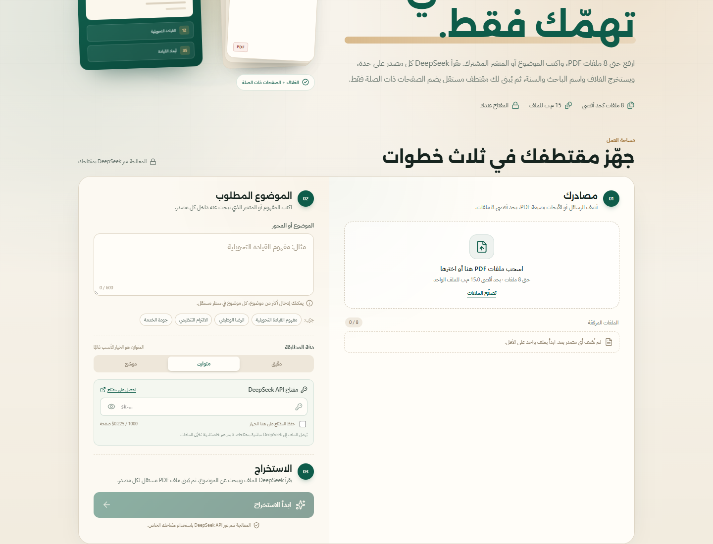

# مُقتطف — Muqtataf

أداة أكاديمية عربية تقرأ ملفات PDF عبر **DeepSeek API**، تبحث عن موضوع محدد داخل كل مصدر، وتنشئ ملف PDF مستقلًا يضم الغلاف والصفحات ذات الصلة فقط.

**الموقع المباشر:** <https://nhadalqysy985-oss.github.io/muqtataf/>



## كيف تعمل؟

1. المستخدم يدخل **مفتاح DeepSeek API** الخاص به.
2. يرفع حتى **8 ملفات PDF**، بحد أقصى **15 م.ب للملف**.
3. يكتب الموضوع، مثل: `مفهوم القيادة التحويلية`.
4. تُرسل كل صفحة إلى DeepSeek OCR لاستخراج النص.
5. تُطابق الصفحات مع الموضوع محليًا داخل المتصفح.
6. يُبنى ملف PDF مستقل لكل مصدر: الغلاف + الصفحات ذات الصلة.
7. يمكن تنزيل كل الملفات كـ ZIP.

## المزايا

- يعمل مع الملفات الممسوحة ضوئيًا والملفات ذات ترميز الخط التالف، لأن القراءة تتم عبر OCR.
- كشف الغلاف وبيانات الباحث والسنة من نص الصفحة الأولى.
- بحث عربي يتجاوز التشكيل واختلاف الهمزات وصيغ الكلمة.
- دعم أكثر من موضوع، كل موضوع في سطر.
- استبعاد الغلاف من التطابق مع إبقائه في الملف الناتج.
- ملف PDF مستقل لكل مصدر + ZIP.
- إدخال مفتاح API من واجهة الموقع، مع خيار حفظه محليًا في المتصفح.
- **عدّاد استهلاك حقيقي** لهذه الأداة: عدد الطلبات (ناجحة/فاشلة)، توكنز الإدخال والإخراج، عدد صفحات OCR، وتكلفة OCR التقديرية. تُحفظ الإحصاءات محليًا لكل مفتاح ويمكن تصفيرها.
- **الباحث العلمي**: بعد الاستخراج تظهر خانة لطلب كتابة نص بحثي عن الموضوع، اعتمادًا على الصفحات المستخرجة نصًا وصورةً، مع توثيق أسماء الباحثين والسنوات وأرقام الصفحات المطبوعة وقائمة مراجع.
- **تحقق آلي تقريبي من الاقتباسات**: يفحص أن اللقب والسنة والصفحة المذكورة في الاقتباس موجودة فعلًا ضمن المقاطع المرسلة، وينبّه إلى أي اقتباس غير مدعوم.
- **تصفية قبل الإرسال**: لا يُرسل الغلاف ولا أي صفحة رقمها المطبوع ليس رقمًا (مثل «ب») أو غير موجود، ولا صفحات المصادر والمراجع؛ لا نصًا ولا صورة.
- **تنظيف الرد**: يمسح علامات Markdown والتطويل، ويحذف فقرات «تنبيه/ملاحظة/ملحوظة» والفقرات الوصفية التي تبدأ بـ«لم أجد/الصفحة المرفقة/قائمة المراجع»، مع إبقاء تحذيرات المحتوى في صندوق منفصل.
- **بيانات غلاف قابلة للمراجعة**: يعرض أسماء الباحثين، اللقب المستخدم للتوثيق، السنة، والسطر الذي أُخذت منه كل معلومة.
- **حد 500 كلمة**: سقف وليس هدفًا. يُكتب كل ما تحتويه الصفحات؛ إن كفت المادة يُقترب من 500، وإن قلت يتوقف عند آخر معلومة. كل جملة تستند إلى النص وتنتهي بتوثيق. بعد الرد يُعرض عدد الكلمات (مثل: 340 كلمة)، وإذا تجاوز 550 يظهر تنبيه دون قطع النص، مع تنبيه «النص مقطوع» إذا كان `finish_reason` هو `length`.
- لا يوجد خادم وسيط تابع لنا، ولا تُخزَّن الملفات عندنا.

## المتطلبات

- **مفتاح DeepSeek API** صالح: <https://platform.deepseek.com/api_keys>
- اتصال بالإنترنت أثناء المعالجة.
- حساب DeepSeek برصيد كافٍ.

### التكلفة

تُحسب قراءة الملفات على حساب DeepSeek. حسب توثيق DeepSeek، سعر OCR هو **$0.225 لكل 1000 صفحة** (تحقق من صفحة الأسعار الحالية). لا توجد تكلفة من موقعنا.

### عدّاد الاستهلاك

يعرض الموقع أرقامًا فعلية من استجابات DeepSeek خلال استخدام هذه الأداة:

- عدد طلبات OCR والمحادثة، وناجحها وفاشلها.
- توكنز الإدخال والإخراج والإجمالي كما تعيدها DeepSeek.
- عدد الصفحات التي تم التعرف عليها.
- تكلفة OCR تقديرية حسب سعر الصفحات المعلن (لا تشمل توكنز المحادثة).

تُخزَّن الإحصاءات في `localStorage` مرتبطة ببصمة المفتاح، وليست كامل استهلاك حساب DeepSeek خارج هذه الأداة. يمكن تصفيرها من زر «تصفير».

## الباحث العلمي

بعد اكتمال الاستخراج تظهر خانة **«الباحث العلمي»** أسفل النتائج. يكتب المستخدم طلبه، مثل:

> اكتب عن مفهوم القيادة التحويلية.

ثم يرسل الموقع إلى DeepSeek Chat (موديل `deepseek-flash`) طلب الكتابة مع:

- بيانات الغلاف لكل مصدر: العنوان، الباحثون، السنة، الجامعة، البلد.
- صيغة التوثيق المحسوبة، مثل `(الغزالي، 2012)`.
- المقاطع النصية للصفحات المستخرجة فقط.
- **صور JPEG للصفحات المستخرجة** (الغلاف + الصفحات المطابقة) ليراجعها النموذج بصريًا، بحد أقصى 32 صورة و24 ميغابايت من البيانات لكل طلب.
- رقم الصفحة المطبوعة إذا أمكن استخراجه، وإلا `[رقم الصفحة غير واضح]`. يُقبل رقم عربي أو حرف عربي (أ، ب، ج...)، ويُفحص أعلى الصفحة أولًا ثم أسفلها.
- السطر الذي أُخذ منه اسم الباحث والسنة، مع محاولة فصل الأسماء الملصوقة مثل `سليمةشريط` وعرض تنبيه إذا تعذّر الفصل.
- التعرف على صيغة «السنة الجامعية 2021/2022» واختيار الرقم الأكبر (2022) للسنة.
- تعليمات صارمة بعدم اختراع المصادر أو الصفحات، وبقاعدة النقل غير المباشر، وبقائمة مراجع في النهاية.

الناتج يُعرض قابلًا للنسخ، ويُحتسب استهلاكه في عدّاد التوكنز والطلبات.

بعد التوليد يفحص الموقع الاقتباسات فحصًا تقريبيًا: هل اللقب والسنة موجودان في المصادر؟ وهل رقم الصفحة المذكور ضمن الصفحات المرفقة؟ الهدف تنبيه المستخدم إلى الاقتباسات غير المدعومة، وليس إثبات صحة كل عبارة.

ويُطابق اللقب مع أي من أسماء الباحثين في الغلاف، ويتجاهل المصدر الواقع بعد «نقلاً عن». تُعرض أيضًا قيمة `finish_reason` لآخر طلب Chat.

قبل إرسال السياق إلى النموذج يستبعد الموقع الغلاف وأي صفحة رقمها المطبوع ليس رقمًا (مثل «ب») أو فارغًا، وكذلك صفحات المصادر والمراجع، فلا يُرسل نصها ولا صورتها. بعد استلام الرد يمسح الكود علامات Markdown والتطويل، ويحذف فقرات التنبيه/الملاحظة والفقرات الوصفية عن غياب التعريف أو الصفحات، ويعرض تحذيرات المحتوى في صندوق منفصل دون تعديل النص. إذا لم تبقَ صفحات محتوى صالحة، لا يُرسل الطلب ويظهر سبب الاستبعاد.

## الخصوصية

- تُرسل ملفات PDF إلى **DeepSeek** مباشرة باستخدام مفتاح المستخدم.
- لا يمر الملف عبر أي خادم تابع لهذا الموقع.
- مفتاح API يبقى في ذاكرة المتصفح، ولا يُحفظ إلا إذا اختار المستخدم «حفظ المفتاح على هذا الجهاز».
- الملفات لا تُخزَّن على موقعنا؛ راجع سياسة خصوصية DeepSeek قبل رفع وثائق حساسة.
- الموقع ثابت ومستضاف على GitHub Pages، بلا قاعدة بيانات أو حسابات.

## التشغيل محليًا

```bash
npm install
npm run dev       # http://localhost:4178
npm run build     # نسخة الإنتاج في dist/
npm run preview   # معاينة نسخة الإنتاج
```

يتطلب Node.js 20+.

## البنية

```
src/
  App.tsx                 الواجهة وتدفق العمل ومفتاح API
  components/
    FileDropzone.tsx      رفع الملفات
    ResultCard.tsx        بطاقة نتيجة لكل مصدر
  lib/
    deepseek.ts           طلب OCR من DeepSeek ومعالجة الاستجابة
    research.ts           الباحث العلمي وسياق المصادر والتوثيق
    extract.ts            مطابقة الصفحات وبناء PDF الناتج وZIP
    pdf.ts                أدوات PDF.js لمعاينة الغلاف
    text.ts               التطبيع العربي وحساب الصلة
    usage.ts              حساب وإحصاءات استهلاك DeepSeek
    format.ts             صيغ الجمع العربية
  styles.css              التصميم المتجاوب RTL
```

## ملاحظات

- جودة OCR تعتمد على وضوح الملف.
- قد تخطئ DeepSeek في بعض الأرقام أو الأسماء أو النصوص الإنجليزية.
- راجع الصفحات المستخرجة قبل الاقتباس.
- الملفات المحمية بكلمة مرور لا يمكن معالجتها إلا بعد إزالة الحماية.
- الحد الأقصى في DeepSeek هو 100 م.ب و1000 صفحة للملف، لكن الأداة تحدّ الملف بـ15 م.ب و8 ملفات لتجربة استخدام معقولة.

## التقنيات

React 19 · TypeScript · Vite · DeepSeek API (`deepseek-flash` + OCR) · PDF.js · pdf-lib · JSZip · Lucide · خطوط Alexandria وIBM Plex Sans Arabic.
